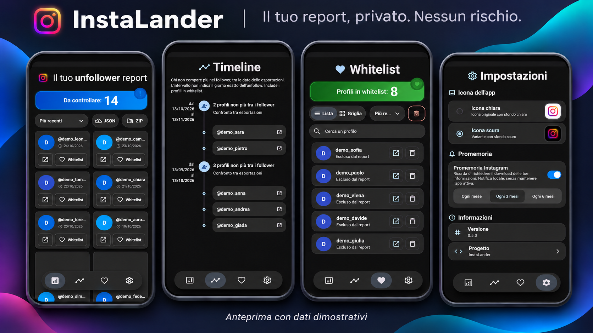

# InstaLander



Applicazione Flutter per Android che confronta i file JSON dell'esportazione Instagram e individua i profili seguiti che non ricambiano il follow. Non richiede l'accesso a Instagram e non usa API o servizi backend.

## Installazione

Scarica gli APK dalla [release più recente](https://github.com/SimpleDevPerson/InstaLander/releases/latest) e installala sul tuo dispositivo Android.

## Funzionalità

- Importazione delle esportazioni Instagram da file JSON o archivi ZIP, con elaborazione locale e senza accesso all'account.
- Report dei profili che segui e che non ricambiano il follow, con ricerca e ordinamento.
- Storico delle importazioni e timeline degli unfollow rilevati tra esportazioni successive.
- Whitelist manuale e automatica per escludere profili dal report.
- Riconoscimento dei possibili cambi di username, con conferma manuale.
- Apertura dei profili su Instagram o nel browser, con indicazione di quelli già visitati.
- Promemoria periodici per richiedere una nuova esportazione.
- Temi Samsung One UI e Material Design Expressive, con modalità chiara e scura.

## Esportazione Instagram

In Instagram, apri il Centro gestione account e vai in **Le tue informazioni e autorizzazioni** → **Esporta le tue informazioni**. Crea un'esportazione per il tuo account, scegli **Esporta sul dispositivo** e imposta il formato **JSON**. I nomi delle voci possono variare leggermente in base alla versione di Instagram.

Quando l'archivio ZIP è pronto, scaricalo e caricalo direttamente in InstaLander con **Carica archivio ZIP**: l'app legge dall'archivio solo i file `followers*.json` e `following*.json` necessari. In alternativa, estrai lo ZIP e seleziona manualmente i JSON (di solito nella cartella `followers_and_following`). Puoi riaprire la guida dalla schermata di setup se ti serve.

L'elaborazione avviene sul dispositivo. I file selezionati e la whitelist sono salvati nell'area documenti privata dell'app; le preferenze del tema e i profili aperti sono salvati localmente. L'app non invia questi dati a un server.

Durante l'importazione JSON l'app usa la data di creazione del file originale, se disponibile sul dispositivo (Android 11 o successivo). Se selezioni più JSON, usa la data più recente; se anche un solo file non espone la data di creazione, si apre il calendario. Per gli archivi ZIP la data resta da scegliere manualmente. I timestamp dei singoli profili rappresentano l'inizio del follow, non la creazione del JSON. Importa insieme tutti i file `followers_*.json` della stessa esportazione e, se disponibile, anche `following*.json`. Ogni nuova importazione sostituisce l'intera lista del tipo selezionato, conservando le versioni precedenti; caricare solo i seguiti non crea un confronto dei follower. Le date devono procedere in ordine cronologico. Per i JSON già presenti prima di questo aggiornamento, la prima data è stimata dalla modifica del file e segnalata nella timeline.

Dal secondo export dei follower, la whitelist viene ampliata con `seguiti attuali − (follower precedenti ∩ follower nuovi)`, mantenendo le esclusioni manuali. La timeline mostra invece `follower precedenti − follower nuovi`, anche se non sono più seguiti o sono in whitelist. L'intervallo non permette di determinare l'istante esatto dell'unfollow; anche account eliminati o disattivati possono risultare assenti.

Quando un follower scompare e un nuovo username compare con lo stesso timestamp di follow (maggiore di zero), l'app propone un possibile cambio di nome, sia per importazioni JSON sia ZIP. Nessuna associazione è preselezionata: puoi confermare le corrispondenze che riconosci, ignorarle o annullare l'importazione. Timestamp uguali non garantiscono che si tratti della stessa persona; nei casi ambigui puoi scegliere tra più candidati, usando ogni nuovo username una sola volta. Le associazioni confermate sono conservate nello storico, escluse dagli unfollow e considerate nel confronto per la whitelist; eventuali voci nei seguiti e nella whitelist passano al nuovo nome. I nomi delle vecchie esportazioni rimangono conservati.

La sezione Promemoria nelle impostazioni permette di scegliere ogni mese, ogni 3 mesi oppure ogni 6 mesi. Il promemoria richiede il permesso per le notifiche su Android 13 e successivi. Parte dopo l’intervallo selezionato dall’attivazione, nello stesso giorno del mese (oppure l'ultimo giorno nei mesi più corti), indicativamente dalle 10:00. Usa un [allarme Android non esatto](https://developer.android.com/develop/background-work/services/alarms), senza servizi persistenti, richieste di rete o motori Flutter in background. La consegna può slittare quando il dispositivo è inattivo; il promemoria viene ripristinato dopo il riavvio. Cambiare frequenza ricalcola la prossima notifica dalla data attuale. Disattivarlo conserva la frequenza scelta e annulla la pianificazione; cancellare tutti i dati ripristina anche la frequenza mensile. Dopo un arresto forzato dalle impostazioni Android, riapri l'app per ripristinare gli allarmi.

I pulsanti della sezione **Debug** aggiungono profili di prova con prefisso `debug_` alla sessione corrente. Ogni sezione può essere popolata separatamente. I dati di prova non vengono salvati nei file importati o nella whitelist persistente e scompaiono al riavvio o alla successiva importazione riuscita. **Cancella tutti i dati**, in fondo alla sezione, continua a richiedere conferma ed elimina anche i dati reali e le preferenze.

## Requisiti

- Flutter 3.38.1 o successivo e Dart SDK compatibile con `pubspec.yaml`.
- Android SDK e un dispositivo o emulatore Android (minimo API 26).

## Sviluppo

Dalla cartella del progetto:

```shell
flutter pub get
flutter run
```

Controlli:

```shell
flutter analyze
flutter test
```

Build APK release per ARMv7, ARM64 e x86_64:

```shell
flutter build apk --release --split-per-abi
```

Gli APK vengono generati in `build/app/outputs/flutter-apk/`, uno per architettura. Per un APK universale, usa `flutter build apk --release` senza `--split-per-abi`. La versione release non richiede annunci se non viene fornito `ADMOB_NATIVE_AD_UNIT_ID`.

Per creare un Android App Bundle:

```shell
flutter build appbundle --release
```

## Struttura

- `lib/models/`: modelli utente e opzioni di ordinamento.
- `lib/providers/`: stato dell'app e preferenze del tema.
- `lib/screens/`: report, timeline, impostazioni e whitelist.
- `lib/services/`: lettura dei file JSON, calcolo dei risultati e persistenza.
- `lib/widgets/`: componenti riutilizzabili dell'interfaccia.
- `android/`: progetto nativo Android.
- `test/`: test Flutter.
