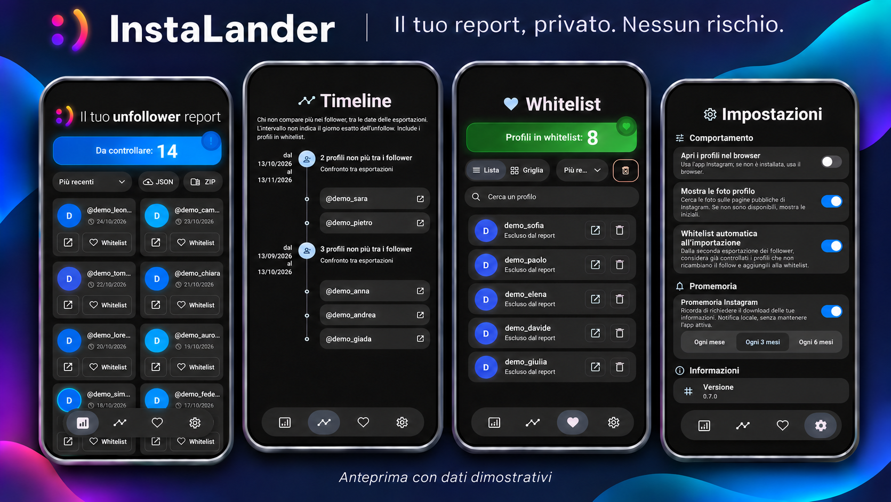

# InstaLander



Applicazione Flutter per Android che confronta i file JSON dell'esportazione Instagram e individua i profili seguiti che non ricambiano il follow. Non richiede l'accesso a Instagram e non usa API o servizi backend.

## Installazione

Scarica l' APK per il tuo dispositvo dalla [release più recente](https://github.com/SimpleDevPerson/InstaLander/releases/latest) e installala sul tuo dispositivo Android.

## Funzionalità

- Importazione delle esportazioni Instagram da file JSON o archivi ZIP, con elaborazione locale e senza accesso all'account.
- Selezione dei JSON o dello ZIP tramite il selettore documenti Android, senza permessi di accesso a tutti i file: l'app riceve solo l'accesso temporaneo in lettura ai documenti scelti.
- Report dei profili che segui e che non ricambiano il follow, con ricerca e ordinamento.
- Storico delle importazioni e timeline degli unfollow rilevati tra esportazioni successive.
- Whitelist manuale e automatica per escludere profili dal report.
- Riconoscimento dei possibili cambi di username, con conferma manuale.
- Apertura dei profili nell'app Instagram o nel browser predefinito, a scelta dalle impostazioni, con indicazione di quelli già visitati.
- Promemoria periodici per richiedere una nuova esportazione.
- Controllo automatico del numero di follower di un profilo scelto, con notifica quando il conteggio cambia.
- Temi Samsung One UI e Material Design Expressive, con modalità chiara e scura.
- Quattro icone selezionabili nelle impostazioni: Smiley face chiara (predefinita), Smiley face scura, Instander chiara e Instander scura. Le scelte già salvate vengono mantenute.
- Interfaccia in italiano, inglese e spagnolo, con rilevamento della lingua del telefono e selezione manuale nelle impostazioni.

## Esportazione Instagram

In Instagram, apri il Centro gestione account e vai in **Le tue informazioni e autorizzazioni** → **Esporta le tue informazioni**. Crea un'esportazione per il tuo account, scegli **Esporta sul dispositivo** e imposta il formato **JSON**. I nomi delle voci possono variare leggermente in base alla versione di Instagram.

Quando l'archivio ZIP è pronto, aprilo con **Carica archivio ZIP** nella schermata iniziale o con **Importa** nel Report. L'app legge solo i file `followers*.json` e `following*.json` necessari. Puoi anche estrarre lo ZIP e selezionare i JSON, che di solito si trovano nella cartella `followers_and_following`. La guida è disponibile dalla schermata iniziale.

Il confronto dei profili avviene sul dispositivo. I file selezionati, la whitelist e le preferenze restano nell'app. Quando **Mostra le foto profilo** è attivo, InstaLander richiede direttamente a Instagram la pagina pubblica dei profili mostrati, usando il loro username nel link. Le foto scaricate restano in memoria per tutta la sessione, anche passando dal report alla whitelist. Puoi disattivarlo in **Impostazioni → Comportamento** per usare le iniziali.

Durante l'importazione JSON l'app confronta il giorno di modifica dei file originali e prova a leggere il giorno di creazione se quello di modifica non è disponibile. Usa la data comune quando i giorni coincidono. Se le date differiscono o ne manca una, apre il calendario. Anche per gli archivi ZIP usa la data del file originale e apre il calendario solo se non è disponibile. I timestamp dei singoli profili rappresentano l'inizio del follow, non la creazione del JSON. Importa insieme tutti i file `followers_*.json` della stessa esportazione e, se disponibile, anche `following*.json`. Ogni nuova importazione sostituisce l'intera lista del tipo selezionato, conservando le versioni precedenti; caricare solo i seguiti non crea un confronto dei follower. Le date devono procedere in ordine cronologico. Per i JSON già presenti prima di questo aggiornamento, la prima data è stimata dalla modifica del file e segnalata nella timeline.

Dopo la prima importazione, caricando uno ZIP puoi scegliere **Solo follower** per aggiornare i follower mantenendo seguiti e cronologia, oppure **Ricomincia da zero** per importare follower e seguiti e azzerare cronologia e whitelist. Il reset richiede entrambe le liste e avviene solo dopo la validazione dei dati.

Nella Timeline, le pillole verdi e rosse distinguono nuovi follower e profili persi. I conteggi aggiungono prima i nuovi e sottraggono poi i persi: il totale intermedio spiega il saldo e non rappresenta una rilevazione in un momento preciso. Il pulsante **?** alla fine della lista apre la guida alla lettura.

Dal secondo export dei follower, **Impostazioni → Comportamento → Whitelist automatica all’importazione** aggiunge solo i profili che seguivi già e che non sono mai comparsi nelle liste follower importate. Chi smette di seguirti resta nel Report finché lo segui e non lo escludi. Un’esclusione automatica registrata scade quando il profilo inizia a seguirti. Le esclusioni manuali e le voci salvate da versioni precedenti si gestiscono dalla scheda Whitelist. La Timeline mostra i follower mancanti anche se non li segui più o sono in whitelist. L'intervallo indica tra quali esportazioni è avvenuta la scomparsa.

Quando un follower scompare e un nuovo username compare con lo stesso timestamp di follow (maggiore di zero), l'app propone un possibile cambio di nome, sia per importazioni JSON sia ZIP. Puoi confermare le corrispondenze che riconosci, ignorarle o annullare l'importazione. Timestamp uguali possono appartenere a profili diversi. Ogni corrispondenza confermata appare in una sola scheda nella timeline con il nome precedente e quello attuale. È esclusa dal conteggio degli unfollow e aggiorna eventuali voci nei seguiti e nella whitelist.

Se importi insieme follower e seguiti, un profilo che prima compariva in entrambe le liste e ora manca da entrambe riceve il tag **Possibile cancellazione**. L'esportazione non indica il motivo della scomparsa.

Il promemoria Instagram in Impostazioni → Notifiche permette di scegliere ogni mese, ogni 3 mesi oppure ogni 6 mesi. Il promemoria richiede il permesso per le notifiche su Android 13 e successivi. Parte dopo l’intervallo selezionato dall’attivazione, nello stesso giorno del mese (oppure l'ultimo giorno nei mesi più corti), indicativamente dalle 10:00. Usa un [allarme Android non esatto](https://developer.android.com/develop/background-work/services/alarms), senza servizi persistenti, richieste di rete o motori Flutter in background. La consegna può slittare quando il dispositivo è inattivo; il promemoria viene ripristinato dopo il riavvio. Cambiare frequenza ricalcola la prossima notifica dalla data attuale. Disattivarlo conserva la frequenza scelta e annulla la pianificazione; cancellare tutti i dati ripristina anche la frequenza mensile. Dopo un arresto forzato dalle impostazioni Android, riapri l'app per ripristinare gli allarmi.

I pulsanti della sezione **Debug** aggiungono profili di prova con prefisso `debug_` alla sessione corrente. Ogni sezione può essere popolata separatamente. I dati di prova non vengono salvati nei file importati o nella whitelist persistente e scompaiono al riavvio o alla successiva importazione riuscita. **Cancella tutti i dati**, in fondo alla sezione, continua a richiedere conferma ed elimina anche i dati reali e le preferenze.

## Privacy

L'[informativa sulla privacy](https://simpledevperson.github.io/InstaLander/) è disponibile in italiano e inglese, anche dalle impostazioni dell'app. La pagina è pubblicata con GitHub Pages dalla cartella `docs/` del branch `main`; il testo si aggiorna modificando `docs/index.html`.

## Requisiti

- Flutter 3.38.1 o successivo e Dart SDK compatibile con `pubspec.yaml`.
- Android SDK e un dispositivo o emulatore Android (minimo API 26).

## Sviluppo

Dalla cartella del progetto:

```shell
flutter pub get
flutter run
```

Controlli:

```shell
flutter analyze
flutter test
```

Build APK release per ARMv7, ARM64 e x86_64:

```shell
flutter build apk --release --split-per-abi
```

Gli APK vengono generati in `build/app/outputs/flutter-apk/`, uno per architettura. Per un APK universale, usa `flutter build apk --release` senza `--split-per-abi`.

Le build release con pubblicità richiedono l'ID dell'app AdMob tramite `ADMOB_APP_ID` (o la proprietà Gradle `adMobAppId`) e l'ID dell'unità nativa tramite `--dart-define=ADMOB_NATIVE_AD_UNIT_ID=...`. Per un APK locale di prova su Android, usa l'unità dimostrativa di Google con `--dart-define=ADMOB_NATIVE_AD_UNIT_ID=ca-app-pub-3940256099942544/2247696110`. L'app richiede il consenso quando previsto.

Per creare un Android App Bundle:

```shell
flutter build appbundle --release
```

### Ottimizzazione delle release Android

Le build release abilitano R8 e la rimozione delle risorse inutilizzate. Flutter aggiunge il profilo `proguard-android-optimize.txt` e le regole per i plugin; il profilo Android preserva anche i nomi necessari ai metodi JNI della lettura delle date. Le build debug e i sorgenti pubblicati su GitHub restano leggibili.

`android/app/proguard-rules.pro` preserva inoltre il costruttore del database generato di WorkManager, creato da Room tramite reflection: le regole della versione Room inclusa non bastano in modalità R8 completa.

Questa configurazione prepara l'app ai [requisiti Google Play da febbraio 2027](https://support.google.com/googleplay/android-developer/answer/17492799): almeno il 25% di ottimizzazione, shrinking e offuscamento quando il codice DEX non compresso supera la soglia di 10 MB. La conformità va verificata sul bundle effettivamente distribuito, tramite i metadati R8 e Android vitals; non si deduce solo dall'attivazione di R8.

Conserva `build/app/outputs/mapping/release/mapping.txt` insieme ai pacchetti di ogni release: serve a interpretare i report di crash. Android Gradle Plugin include automaticamente la mappatura nel bundle. Per misurare dimensioni DEX e percentuali secondo Android vitals, usa `android analyze --format=json percorso/app.aab`, se Android CLI è disponibile, oppure l'analisi del bundle nella Play Console. Vedi la [documentazione DEX](https://developer.android.com/google/play/vitals/code-optimization).

## Struttura

- `lib/models/`: modelli utente e opzioni di ordinamento.
- `lib/providers/`: stato dell'app e preferenze del tema.
- `lib/screens/`: report, timeline, impostazioni e whitelist.
- `lib/services/`: lettura dei file JSON, calcolo dei risultati e persistenza.
- `lib/widgets/`: componenti riutilizzabili dell'interfaccia.
- `android/`: progetto nativo Android.
- `test/`: test Flutter.
